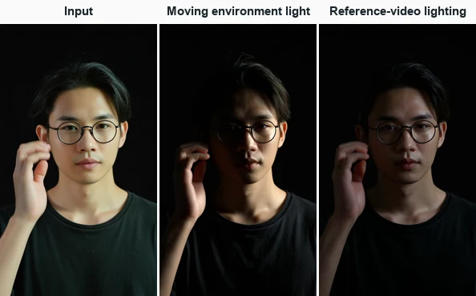
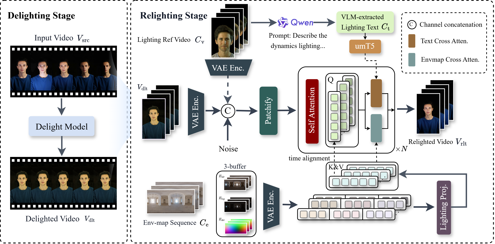
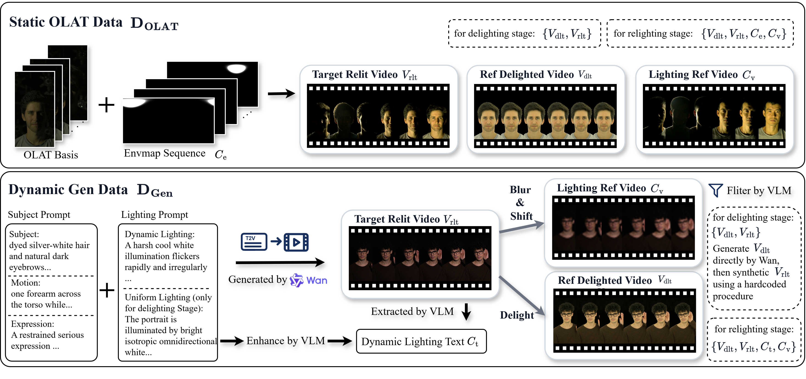
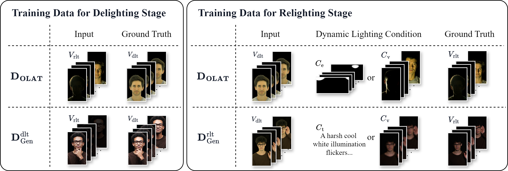
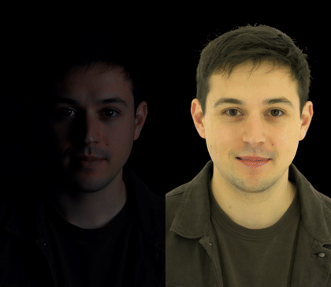
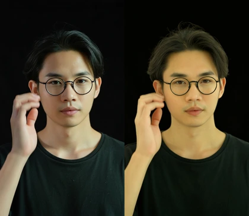
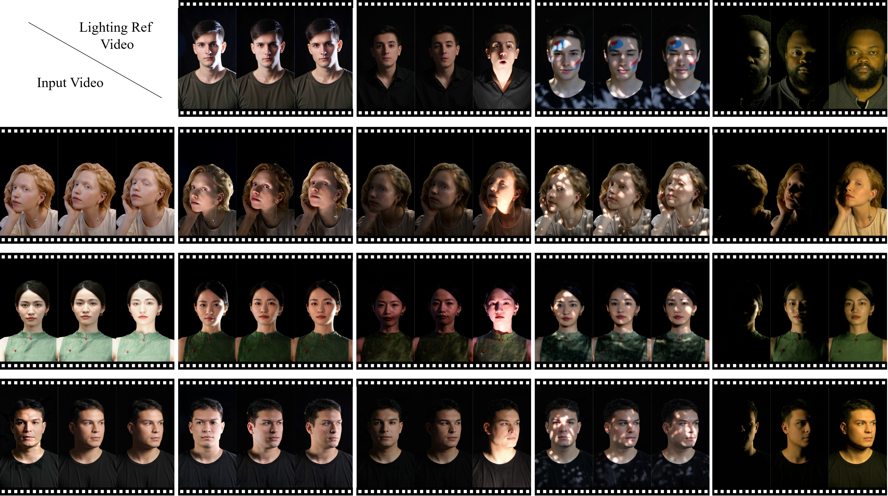

<h1 align="center">⚡ FlashRelight</h1>
<p align="center"><strong>Portrait Video Relighting with Dynamic Lighting</strong><br>NeurIPS 2026</p>

<p align="center">
  Jiahui Sheng<sup>1,*</sup>, Le Li<sup>2,†</sup>, Limin Lin<sup>2</sup>, Jiahao Li<sup>2</sup>, Wansen Feng<sup>2</sup>, Hong Gu<sup>2</sup>, Shuhan Chen<sup>1</sup>, Xiaorun Li<sup>1,‡</sup>, Rui Hu<sup>2,‡</sup><br>
  <sup>1</sup> Zhejiang University, China · <sup>2</sup> vivo BlueImage Lab, vivo Mobile Communication Co., Ltd., China<br>
  <sub>* Work done during an internship at vivo. &nbsp; † Project leader. &nbsp; ‡ Corresponding authors.</sub>
</p>
<p align="center">
  <a href="https://arxiv.org/abs/2611.06355"></a>
  <a href="https://huggingface.co/JiahuiSheng/FlashRelight"></a>
  <a href="https://openreview.net/forum?id=K4Vqa2QXge"></a>
</p>


**FlashRelight** relights portrait videos with an HDR environment map or transfers lighting from a reference video. Its first stage, **FlashDelight**, can also run on its own to suppress the original lighting.

<p align="center"></p>

## 🧩 Method

FlashDelight estimates a neutrally lit portrait video. FlashRelight uses that estimate and a frame from the input video to preserve the subject’s appearance while applying the target lighting.



## 🗂️ Training data

We render **24,000 video pairs** from static one-light-at-a-time (OLAT) captures using known lighting sequences. **Over 10,000 generated video pairs** show subjects moving under changing light.



<details>
<summary>How the training pairs differ between the two stages</summary>

For FlashDelight, we add synthetic lighting changes to generated, neutrally lit clips. For FlashRelight, we generate clips under changing light and use FlashDelight to produce their neutral counterparts.



</details>

## 🎬 Examples

<a name="delighting-examples"></a>

### Delighting

Each pair shows the original video on the left and the FlashDelight output on the right.

<p align="center">
  
  
</p>

### Relighting

Each comparison below shows the input portrait, lighting control, delighted portrait, and relit result, from left to right.

| Lighting control | Watch the comparison |
| --- | --- |
| HDR sequence | [Light moving around the portrait](docs/examples/great_circle.mp4) |
| Single HDR panorama (fixed or rotating) | [Meadow 2 rotating at 60°/s](docs/examples/rotating_meadow.mp4) |
| Reference video | [Studio light sweeping across the face](docs/examples/studio_sweep.mp4) |
| Text prompt | [Dappled light moving across the face](docs/examples/dappled_light.mp4) |

<details>
<summary>Compare reference lighting across portraits</summary>

The top row shows the reference lights. Each row below shows an input portrait on the left and its relit results under each reference.



</details>

<a name="quick-start"></a>

## 🚀 Quick start

### 1. Install

Use Linux, Conda, and an NVIDIA GPU. The default environment uses Python 3.10 and PyTorch 2.1.0 with CUDA 12.1, as tested on the H20.

```bash
git clone https://github.com/vivoCameraResearch/FlashRelight.git
cd FlashRelight
bash install.sh
conda activate flashrelight
```

For the RTX 5090 D examples, we used Python 3.11 and PyTorch 2.14.0+cu132. If you already have a PyTorch environment for your GPU, install the remaining packages with `pip install -r requirements.txt`.

### 2. Weights

Download the FlashDelight and FlashRelight checkpoints together with the shared Wan2.1 files. [Hugging Face weights](https://huggingface.co/JiahuiSheng/FlashRelight)

```bash
python scripts/download_weights.py --dest weights --skip_matting_model
```

The bundled portraits already have black backgrounds. For footage that needs background removal, omit `--skip_matting_model` during setup and use `--matting birefnet` at inference. [Offline setup and weight layout](weights/README.md)

### 3. Relight

```bash
python scripts/infer.py --source assets/sources/generated_gesture.mp4 --matting none \
  --mode env --env_map assets/envmaps/04_random_great_circle
```

Open `outputs/generated_gesture_env_relit.mp4` for the relit portrait (49 frames, 480 × 832 pixels, 16 fps). The same folder contains the delighted portrait (`*_delit.mp4`) and the comparison (`*_compare.mp4`).

For your own input, pass a portrait video or still image to `--source`. All six bundled environment maps retain their original HDR values. FlashRelight applies the 0.1 scale automatically during inference.

Run all four examples with `python scripts/infer.py --samples assets/samples.json`. [Sample configurations](assets/samples.json)

<details>
<summary><strong>Use a single panorama, a reference video, or a text prompt</strong></summary>

**Single HDR panorama.** A panorama stays fixed for all 49 frames by default. Set `--env_rotation_speed` in degrees per second to rotate it. Positive values move the light to the right in the panorama preview.

```bash
python scripts/infer.py --source assets/sources/generated_portrait.mp4 --matting none \
  --mode env --env_map assets/envmaps/meadow_2_4k.exr --env_rotation_speed 60
```

The `--env_map` flag accepts a single EXR/HDR panorama, a directory of ordered EXR/HDR frames, or a NumPy array such as `[T,3,H,W]`. The model resizes each map to 128 × 64 pixels.

**Reference video.** Transfer the lighting from the studio clip to a different portrait.

```bash
python scripts/infer.py --source assets/sources/generated_gesture.mp4 --matting none \
  --mode light_ref --light_ref assets/light_refs/studio_sweep.mp4
```

**Text prompt.** Text control works best with lighting descriptions close to the training captions. [Example prompts](assets/prompts.txt)

```bash
python scripts/infer.py --source assets/sources/generated_portrait.mp4 --matting none \
  --mode text --prompt "Across the face, irregular dappled light patches wander with an organic motion."
```

</details>

<a name="standalone-delighting"></a>

## 🌓 Standalone FlashDelight

To run delighting alone, use the FlashDelight checkpoint and the shared Wan2.1 files. If you already prepared both stages, go straight to the inference command.

```bash
python scripts/download_weights.py --dest weights --delight_only --skip_matting_model

python scripts/infer.py --delight_only --source assets/sources/generated_portrait.mp4 --matting none
```

This writes `outputs/generated_portrait_delit.mp4`. For the portrait with glasses, use `--source assets/sources/generated_gesture.mp4`. [See both delighting results](#delighting-examples)

<details>
<summary>Use FlashDelight from Python</summary>

```python
from flashrelight import FlashRelightPipeline
from flashrelight.utils import video_io

pipe = FlashRelightPipeline("weights", delight_only=True)
frames = pipe.preprocess("assets/sources/generated_portrait.mp4", matting="none")
video_io.save_mp4(pipe.delight_frames(frames), "delighted.mp4", fps=16)
```

</details>

<a name="demo"></a>

## 🎛️ Gradio demo

Gradio lets you run FlashRelight from a browser. After preparing the weights, start the web interface on your GPU machine.

```bash
python app.py --matting none
```

Open the local URL printed in the terminal. Choose a bundled portrait or upload your own, select a lighting control, and click **Relight**. For a delighting-only interface, run `python app.py --delight_only --matting none`.

## 🙏 Acknowledgements

FlashRelight uses the DiT, 3D VAE, and umT5 text encoder from [Wan2.1](https://github.com/Wan-Video/Wan2.1).
We use [BiRefNet](https://github.com/ZhengPeng7/BiRefNet) for optional portrait matting.
The examples include HDR maps from [Poly Haven](https://polyhaven.com) ([CC0](https://polyhaven.com/license)).

[Example asset credits](assets/README.md) · [Third-party software](THIRD_PARTY_NOTICES.md)

## 📖 Citation

```bibtex
@misc{sheng2026flashrelightportraitvideorelighting,
      title={FlashRelight: Portrait Video Relighting with Dynamic Lighting},
      author={Jiahui Sheng and Le Li and Limin Lin and Jiahao Li and Wansen Feng and Hong Gu and Shuhan Chen and Xiaorun Li and Rui Hu},
      year={2026},
      eprint={2611.06355},
      archivePrefix={arXiv},
      primaryClass={cs.CV},
      url={https://arxiv.org/abs/2611.06355},
}
```
